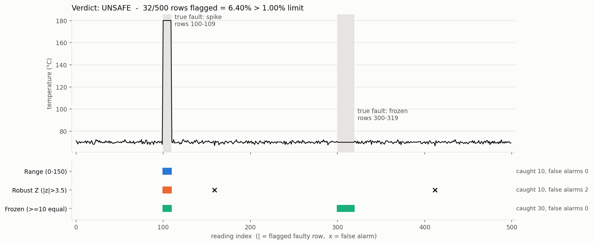

# 🛡️ Smart Sensor Data Quality Guardrail

**[TR]** Endüstriyel sensör verisini yapay zekâ modellerine gitmeden önce denetleyen bir veri kalitesi katmanı. Üç istatistiksel/kural tabanlı kontrol, deterministik bir SAFE/UNSAFE kararı ve kararı sadece *açıklayan* bir LLM içerir.

**[EN]** A data quality layer that checks industrial sensor data before it reaches AI models. It has three statistical/rule-based checks, a deterministic SAFE/UNSAFE verdict, and an LLM that only *explains* the verdict.

---

## 📊 Results / Sonuçlar

`python -m src.pipeline --plot assets/pipeline_result.png` (n = 500, seed = 10):



```
Rows: 500   Faulty rows (ground truth): 30

          flagged  caught  false_alarms  missed  spike (/10)  frozen (/20)
range          10      10             0      20           10             0
robust_z       12      10             2      20           10             0
frozen         30      30             0       0           10            20
ANY            32      30             2       0           10            20

VERDICT: UNSAFE  (32/500 rows flagged = 6.40% > 1.00% limit)
```

**[TR] Yorum**
- 30 hatalı satırın tamamı yakalandı (`ANY`, `missed = 0`).
- **Donmuş sensör** (300–319. satırlar, sabit 70) sadece `frozen` kontrolüyle yakalanıyor. Değer medyana (70.05) eşit olduğu için hiçbir Z-skoru onu göremez. Eski mean/std yönteminde bu satırların Z-skoru **−0.14** idi.
- `frozen` kontrolü 180'deki sıçramayı da işaretliyor, çünkü o da 10 ölçüm boyunca sabit kalıyor. Bu satırlar gerçekten hatalı olduğundan yanlış alarm sayılmaz.
- `robust_z` iki **yanlış alarm** veriyor (159: 67.02 °C, z = −3.58; 412: 66.80 °C, z = −3.84). Bunlar normal gürültünün kuyruğundaki ölçümler. Eşik 4.0 yapılırsa yanlış alarm 0'a iner, sıçramanın z değeri ise ~130 olduğu için yine yakalanır. Literatürdeki standart 3.5 eşiği bilinçli olarak korundu.

**[EN] Interpretation**
- All 30 faulty rows are caught (`ANY`, `missed = 0`).
- The **frozen sensor** (rows 300–319, constant 70) is caught only by the `frozen` check. Its value equals the median (70.05), so no Z-score can see it. With the old mean/std method these rows scored **−0.14**.
- `frozen` also flags the 180 spike, since it is constant for 10 readings as well. Those rows really are faulty, so they are not false alarms.
- `robust_z` raises two **false alarms** (159: 67.02 °C, z = −3.58; 412: 66.80 °C, z = −3.84). These are tail values of normal noise. A threshold of 4.0 would remove them, and the spike (z ≈ 130) would still be caught. The standard 3.5 threshold was kept on purpose.

---

## 🧠 Checks / Kontroller

| Check | [TR] | [EN] |
|---|---|---|
| `range` | Fiziksel sınır dışı (0–150 °C) | Outside physical limits (0–150 °C) |
| `robust_z` | Medyan/MAD tabanlı Z-skoru, \|z\| > 3.5 | Median/MAD-based Z-score, \|z\| > 3.5 |
| `frozen` | ≥ 10 ardışık ölçüm boyunca değişmeyen değer | Value unchanged for ≥ 10 consecutive readings |

**Robust (modified) Z-score** (Iglewicz & Hoaglin):

$$M_i = \frac{0.6745\,(x_i - \tilde{x})}{\mathrm{MAD}}, \qquad \mathrm{MAD} = \mathrm{median}\left(|x_i - \tilde{x}|\right)$$

**[TR] Neden robust?** Klasik $Z=(x-\mu)/\sigma$ yönteminde 10 adet 180 °C ölçümü ortalamayı 72.23'e, standart sapmayı 15.44'e çekiyordu. Robust yöntemde medyan 70.05, MAD 0.57 oluyor. Aykırı değerler referansı bozmuyor ve gerçek gürültü ölçeğine göre değerlendiriliyor. MAD = 0 olduğunda ortalama mutlak sapmaya geçilir.

**[EN] Why robust?** With the classic $Z=(x-\mu)/\sigma$, ten 180 °C readings dragged the mean to 72.23 and the std to 15.44. The robust version uses median 70.05 and MAD 0.57, so outliers cannot distort the reference and values are judged against the real noise scale. If MAD = 0, it falls back to the mean absolute deviation.

## ⚖️ Verdict / Karar

**[TR]** Karar kurala bağlıdır: herhangi bir kontrolün işaretlediği satırların oranı **%1'i geçerse UNSAFE**, aksi halde SAFE (`src/pipeline.py`, `decide`, `--max-ratio` ile ayarlanabilir). LLM (`gpt-4o-mini`) kararı hazır olarak alır ve sadece açıklama yazar. Prompt, kararı değiştirmesini yasaklar. LLM'e jeneratörün gerçek etiketleri gönderilmez.

**[EN]** The verdict is rule-based: if the share of rows flagged by any check **exceeds 1 %, the data is UNSAFE**, otherwise SAFE (`src/pipeline.py`, `decide`, configurable with `--max-ratio`). The LLM (`gpt-4o-mini`) receives the verdict as given and only writes an explanation. The prompt forbids it from changing the verdict. The generator's ground-truth labels are never sent to the LLM.

---

## ▶️ Usage / Kullanım

```bash
pip install -r requirements.txt

python -m src.pipeline                                   # report / rapor
python -m src.pipeline --plot assets/pipeline_result.png # + chart / grafik
python -m src.pipeline --explain                         # + LLM explanation (needs OPENAI_API_KEY in .env)
python -m unittest discover -s tests                     # tests / testler
streamlit run app.py                                     # dashboard
```

## 📂 Project Structure / Proje Yapısı

- `src/generator.py`: [TR] Hatalı veri ve satır bazlı etiket (`ok` / `spike` / `frozen`) üretir. [EN] Generates faulty data and row-level labels.
- `src/validator.py`: [TR] `range`, `robust_z`, `frozen` kontrolleri (boolean maskeler). [EN] The three checks, as boolean masks.
- `src/pipeline.py`: [TR] Değerlendirme, karar kuralı, grafik, CLI. [EN] Evaluation, verdict rule, plot, CLI.
- `src/describer.py`: [TR] Kararı LLM ile açıklar. [EN] LLM explanation of the verdict.
- `app.py`: [TR] Pipeline sonucunu gösteren Streamlit arayüzü. [EN] Streamlit UI on top of the pipeline.
- `tests/`: [TR] Birim testleri. [EN] Unit tests.

## 🛠️ Tech Stack

Python · NumPy · Pandas · Matplotlib · Streamlit · OpenAI API (`gpt-4o-mini`, explanation only)
